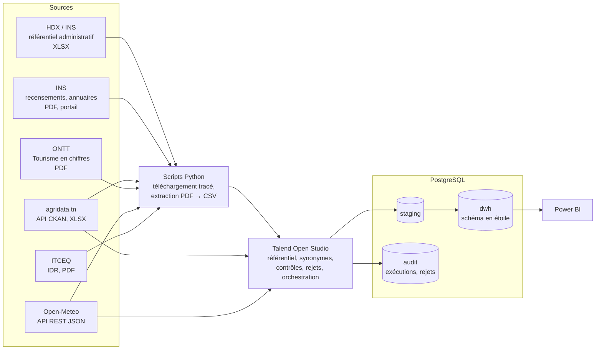

# Observatoire des disparités régionales en Tunisie

**Un entrepôt de données qui intègre des sources publiques tunisiennes hétérogènes (PDF, Excel, API) pour mesurer les écarts entre les 24 gouvernorats.**

Chaîne : sources brutes → **Talend** (nettoyage, référentiel géographique, contrôles qualité, orchestration) → **PostgreSQL** (schéma en étoile) → **Power BI**.

> *In short (EN): a documented data-integration project that consolidates scattered Tunisian open data (PDF reports, Excel files, REST APIs, inconsistent territorial units) into a single, traceable PostgreSQL star schema built with Talend, with Power BI on top. The composite index it produces is compared with the official regional development index (IDR) published by ITCEQ.*

**État :** en cours de construction. Voir la section [Avancement](#avancement).

---

## Pourquoi ce projet

Les disparités régionales en Tunisie sont un sujet bien étudié. L'ITCEQ (Institut tunisien de la compétitivité et des études quantitatives) publie un indice officiel, l'**Indicateur de développement régional (IDR)**. La Banque mondiale et l'OCDE ont aussi travaillé sur ces écarts.

Ce projet ne propose donc pas une nouvelle mesure du développement. C'est un **projet d'intégration de données**. Les chiffres régionaux existent, mais ils sont dispersés entre plusieurs organismes, publiés dans des formats différents (rapports PDF, fichiers Excel, API) et rattachés à des découpages territoriaux qui ne coïncident pas : gouvernorats, régions touristiques, points GPS. L'objectif est de les réunir dans un entrepôt unique où **chaque valeur peut être suivie jusqu'à son fichier source**.

L'IDR officiel sert de **référence externe** : l'indice composite calculé à partir des données ouvertes lui est comparé, et les écarts sont analysés. Il ne s'agit pas de concurrencer l'IDR.

## Architecture



| Couche | Rôle |
|---|---|
| `data/raw/` | Fichiers téléchargés, **jamais modifiés**. Chaque fichier est inscrit dans un manifeste (URL, date, empreinte SHA-256). |
| Python | Téléchargement traçable et extraction des tableaux PDF en CSV. Ces étapes sont faites hors Talend et présentées comme telles. |
| Talend | Tous les chargements : lecture des sources, rapprochement des libellés avec le référentiel géographique, contrôles, flux de rejets, orchestration. |
| `staging` | Copie fidèle des sources, sans nettoyage. |
| `dwh` | Dimensions, table de faits, référentiels de correspondance, vues pour Power BI. |
| `audit` | Journal des exécutions et lignes rejetées, avec leur motif. |

## Les difficultés d'intégration

C'est le cœur du projet. Chaque règle est consignée dans le [journal des décisions](docs/decisions.md).

1. **Un référentiel géographique maître.** Le P-code du référentiel administratif HDX (`TN11` à `TN63`) est la clé de l'entrepôt. Une table de synonymes rattache chaque libellé source à un P-code : variantes d'orthographe (Béja / Beja, Manouba / Manubah, Sidi Bouzid / Sidi Bou Zid), formes arabes et libellés propres à chaque tableau. Tout libellé inconnu part dans un flux de rejets, revu avant d'enrichir la table.
2. **Des zones touristiques qui ne sont pas des gouvernorats.** L'ONTT publie ses statistiques hôtelières par région touristique (Djerba-Zarzis, Nabeul-Hammamet, Gafsa-Tozeur…). Une table pont, avec des poids documentés, les rattache aux gouvernorats. Les volumes et les ratios n'y sont pas traités de la même façon.
3. **Des données enfermées dans des PDF**, extraites puis contrôlées contre les totaux publiés.
4. **Des fréquences et des unités différentes** : recensements décennaux, tourisme annuel, météo journalière agrégée à l'année ; milliers d'habitants, tonnes, pourcentages, milliers de dinars.
5. **Des découpages qui changent** : six grandes régions dans le référentiel HDX, cinq districts créés par le décret n° 2023-589.

## Sources

| Source | Contenu | Format |
|---|---|---|
| [HDX — référentiel administratif INS / OCHA](https://data.humdata.org/dataset/e47eda48-8f83-4858-b739-dbffb8a50c47) | Codes et noms des gouvernorats (français, arabe), contours | XLSX, SHP |
| [INS — recensements 2014 et 2024](https://ins.tn/en/publication/population-and-housing-census-2024) | Population, emploi, conditions de vie | PDF, tableaux |
| [INS — portail de données](http://dataportal.ins.tn/) | Séries socio-économiques | API XML |
| [INS — Annuaire statistique](https://ins.tn/sites/default/files-ftp3/files/publication/pdf/annuaire-2023avec%20lien.pdf) | Éducation, santé, équipements | PDF |
| [agridata.tn](https://catalog.agridata.tn/) | Production agricole, eau potable | XLSX, API CKAN |
| [ONTT — Tourisme en chiffres](https://www.tourisme.gov.tn/) | Capacité hôtelière, occupation, investissements | PDF |
| [Open-Meteo](https://open-meteo.com/) | Températures, précipitations (archive ERA5), géocodage | API REST |
| [ITCEQ — IDR 2024](https://www.itceq.tn/lindice-du-developpement-regional-2024/) | Classement de référence | PDF |
| Décret n° 2023-589 (JORT n° 108 du 22 septembre 2023) | Rattachement des gouvernorats aux cinq districts | PDF |

Inventaire détaillé, contenu exploitable et constats par source : [`docs/sources.md`](docs/sources.md).

## Modèle de données

Base `tunisia_dwh`, schémas `staging`, `dwh` et `audit`.

| Table | Contenu | État |
|---|---|---|
| `dwh.dim_gouvernorat` | 24 gouvernorats : P-code, noms français, arabe et sans accents, district, région, superficie, coordonnées | Créée |
| `staging.stg_hdx_admin2` | Copie fidèle de la feuille HDX des gouvernorats | Créée |
| `audit.etl_run_log`, `audit.etl_rejets` | Exécutions et rejets | Créées |
| `dwh.ref_synonyme_geo` | Libellé source → P-code, par source et par tableau | Prévue |
| `dwh.dim_zone_touristique`, `dwh.bridge_zone_gouvernorat` | Pont zones touristiques → gouvernorats | Prévues |
| `dwh.dim_temps`, `dwh.dim_indicateur`, `dwh.dim_source` | Année, catalogue des indicateurs (unité, sens), sources | Prévues |
| `dwh.fact_indicateur_regional` | Gouvernorat × année × indicateur | Prévue |
| `dwh.ref_idr_itceq`, `dwh.v_comparaison_idr` | Référence IDR et comparaison avec l'indice du projet | Prévues |

Les définitions de colonnes sont dans les scripts [`sql/`](sql/) (commentaires SQL) ; un dictionnaire de données suivra dans `docs/`.

## Avancement

- [x] **Phase 0 — Vérifications** : environnement, inventaire, accès aux sources, rapport IDR 2024, découpage en districts
- [x] Base, schémas, tables d'audit et dimension gouvernorat (DDL)
- [ ] **Phase 1 — Référentiel géographique** : job `J01_Referentiel_Geo` (en cours), table de synonymes
- [ ] Phase 2 — Sources simples : agridata, Open-Meteo
- [ ] Phase 3 — INS : recensements, annuaires, portail de données
- [ ] Phase 4 — Tourisme : extraction PDF, pont zones → gouvernorats
- [ ] Phase 5 — Qualité et orchestration : job maître, audit, rapport qualité
- [ ] Phase 6 — Power BI : carte, indice composite, côte / intérieur, tourisme, comparaison avec l'IDR
- [ ] Phase 7 — Publication

### Jobs Talend prévus

| Job | Rôle |
|---|---|
| `J00_Master` | Orchestration, contextes, gestion d'erreurs |
| `J01_Referentiel_Geo` | Référentiel HDX → `dim_gouvernorat` |
| `J02_Synonymes` | Table de synonymes et contrôle |
| `J10` à `J15` | Une ingestion par source (agridata, recensements, annuaires, tourisme, météo, IDR) |
| `J20_Dimensions`, `J30_Fact` | Dimensions et chargement incrémental des faits |
| `J90_Qualite` | Complétude par source et par année, rejets, contrôles de totaux |

## Démarrer

**Prérequis :** PostgreSQL (développé sur la version 18), Python 3.11 ou plus récent, Talend Open Studio for Data Integration 8.0.1, Java 17, Power BI Desktop.

```bash
# 1. Environnement Python
python -m venv .venv
.venv\Scripts\activate            # Windows (source .venv/bin/activate ailleurs)
pip install -r requirements.txt

# 2. Configuration locale : copier le modèle, puis compléter PGPASSWORD et RACINE_PROJET
copy .env.example .env

# 3. Base, utilisateur applicatif et schémas (avec un compte administrateur)
psql -U postgres -h localhost -f sql/00_creation_base.sql

# 4. Tables (avec l'utilisateur applicatif ; psql lit les variables PG* de l'environnement)
psql -f sql/01_audit.sql
psql -f sql/02_staging_hdx.sql
psql -f sql/03_dwh_dim_gouvernorat.sql

# 5. Téléchargement d'un fichier source, consigné dans le manifeste
python scripts/telecharger.py hdx <url>
```

Le fichier `.env` est la configuration unique, partagée par psql, Python et Talend : voir [`docs/architecture.md`](docs/architecture.md).

## Structure du dépôt

```
├── data/
│   ├── raw/<source>/                 fichiers téléchargés, jamais modifiés
│   ├── extracted/                    CSV extraits des PDF
│   ├── reference/                    tables de correspondance établies à la main, sourcées
│   └── manifest_telechargements.csv  URL, date et SHA-256 de chaque fichier brut
├── scripts/                          téléchargement, extraction, contrôles (Python)
├── sql/                              DDL, contrôles qualité, vues
├── talend/                           export des jobs
├── docs/                             sources, décisions, architecture, dictionnaire, qualité
└── powerbi/                          rapport
```

## Principes de travail

- **Aucune donnée inventée.** Chaque valeur chargée vient d'un fichier identifié (source, fichier, page ou feuille, date de téléchargement). Une donnée manquante reste vide et c'est documenté.
- **Données brutes intouchables.** Toute transformation produit un nouveau fichier ou une nouvelle table.
- **Décisions tracées.** Règles de mapping, de répartition et de dédoublonnage : date, problème, options, choix, justification dans [`docs/decisions.md`](docs/decisions.md).
- **Fichiers volumineux.** Les fichiers bruts de plus de 10 Mo ne sont pas versionnés ; le manifeste permet de les retélécharger et d'en vérifier l'empreinte.

## Limites

- **Faible volume.** 24 gouvernorats, une dizaine d'années, quelques dizaines d'indicateurs : quelques milliers de lignes. Le projet montre la qualité d'intégration et la traçabilité, pas le passage à l'échelle.
- **Comparaison partielle avec l'IDR.** Le rapport IDR 2024 ne publie en texte que les rangs des cinq premiers et des cinq derniers gouvernorats ; pour les autres, seule une classe de score est lisible sur une carte ([décision D-007](docs/decisions.md)).
- **Un point par gouvernorat pour la météo.** Les coordonnées du chef-lieu ne rendent pas compte des écarts internes à un gouvernorat ([décision D-003](docs/decisions.md)).
- **Talend Open Studio n'est plus maintenu** depuis janvier 2024. La version 8.0.1 reste utilisable ici ; des pistes de migration seront présentées en fin de projet.

## Licences et attributions

Le code et la documentation de ce dépôt sont sous [licence MIT](LICENSE). Les données sources restent sous les conditions de leurs éditeurs :

- **Référentiel administratif** : INS / OCHA, via HDX, licence CC BY-IGO.
- **Météo** : *Weather data by [Open-Meteo.com](https://open-meteo.com/)*, CC BY 4.0.
- **Géocodage** : *Location data based on [GeoNames](https://www.geonames.org/)*, CC BY 4.0.
- **IDR** : © ITCEQ. Le rapport n'est pas redistribué dans ce dépôt (reproduction soumise à autorisation écrite) ; seules les valeurs nécessaires à la comparaison sont citées, avec leur référence.
- **INS, ONTT, agridata.tn** : conditions de réutilisation précisées source par source dans [`docs/sources.md`](docs/sources.md) au fur et à mesure de l'intégration.

## Auteur

**Ahmed Ben Arfa** — Executive Master Business Analytics, ESPRIT School of Business, Tunis
[github.com/AhmedBenArfa](https://github.com/AhmedBenArfa)
