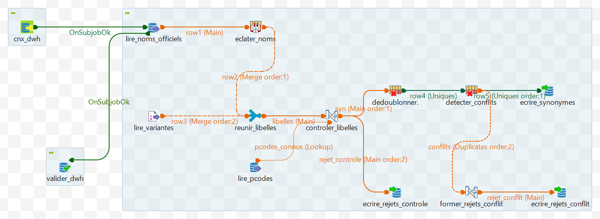
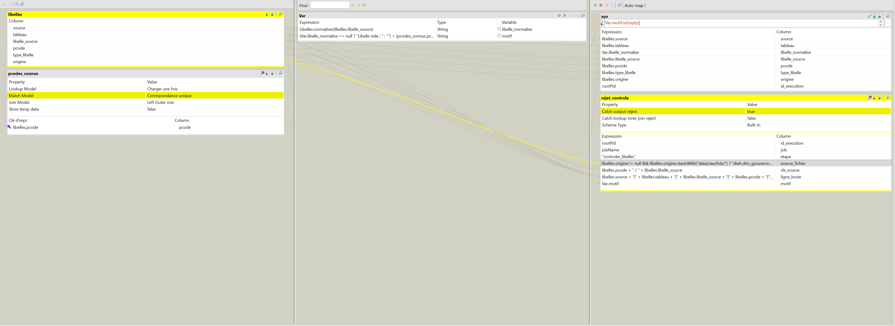
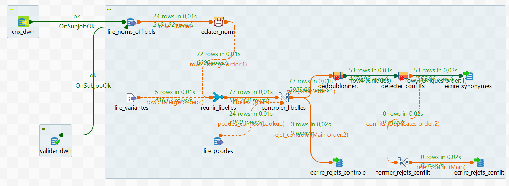

# Guide 3 — Job `J02_Synonymes`

*Observatoire des disparités régionales en Tunisie — Ahmed Ben Arfa*

**Statut :** job terminé et vérifié (11 novembre 2026) : 53 synonymes dans `dwh.ref_synonyme_geo`, 0 rejet, 0 écart avec un calcul indépendant de la normalisation, flux de rejets testés.

Le job exporté depuis Talend Studio se trouve dans [`talend/TUNISIA_DWH/process/`](../../talend/TUNISIA_DWH/process/). Règles de conception : [décision D-012](../decisions.md).

---

## 1. Rôle du job

Chaque source écrit les gouvernorats à sa façon : « Béja » ou « Beja », « l’Ariana », « la Manouba », « Kef » au lieu de « Le Kef », « Sidi Bouzid » au lieu de « Sidi Bou Zid » (forme HDX). `J02_Synonymes` construit la table qui rattache **chaque libellé rencontré** à son P-code. Tous les jobs de chargement de sources s'en serviront pour trouver le gouvernorat d'une ligne.

La table est **entièrement recalculée** à chaque exécution, à partir de deux entrées :

| Entrée | Contenu | Origine |
|---|---|---|
| `dwh.dim_gouvernorat` | Noms officiels : français, arabe, sans accents | Référentiel HDX, chargé par J01 |
| `data/reference/synonymes_geo.csv` | Variantes réellement observées dans les sources, avec leur origine (fichier, page) | Relevé manuel, vérifié |

Les 5 variantes actuelles viennent du décret n° 2023-589 et du rapport IDR 2024 de l'ITCEQ : `l’Ariana`, `la Manouba`, `Manouba`, `Kef`, `Sidi Bouzid`. Les autres graphies relevées dans ces documents (Béja / Beja, Kébili / Kebili, Gabès / Gabes, Kasserine…) se ramènent au nom HDX par la seule normalisation et n'ont pas besoin d'entrée.

## 2. La normalisation : une routine partagée

Deux libellés sont considérés comme identiques s'ils ont la même **forme normalisée**. La règle est écrite une seule fois, dans une **routine Talend** (`Code → Routines → Libelles`), utilisable par tous les jobs du projet :

```java
public static String normaliser(String libelle) {
    if (libelle == null) {
        return null;
    }
    String s = Normalizer.normalize(libelle, Normalizer.Form.NFD);
    s = s.replaceAll("\\p{M}", "");                        // accents, hamza, voyelles arabes
    s = s.replace("\u0640", "");                           // tatweel
    s = s.replace('\u0649', '\u064A').replace('\u0629', '\u0647'); // alif maqsura -> ya, ta marbuta -> ha
    s = s.toLowerCase(Locale.ROOT);
    s = s.replaceAll("[\\p{Punct}\u2018\u2019\u2013\u2014\u00A0]", " "); // ponctuation, apostrophes et tirets typographiques
    s = s.replaceAll("(?U)\\s+", " ").trim();
    return s.isEmpty() ? null : s;
}
```

| Libellé source | Forme normalisée |
|---|---|
| `Béja`, `Beja`, `BEJA` | `beja` |
| `l’Ariana`, `L’Ariana`, `l'Ariana` | `l ariana` |
| `سليانـــة`, `سليانة` | `سليانه` |
| `أريانة`, `اريانة` | `اريانه` |

Les articles sont **conservés** : `Le Kef` et `Kef` sont deux formes distinctes, chacune présente dans la table parce qu'elle a été observée (D-012).

La même règle existe en Python (`scripts/normaliser_libelle.py`), uniquement pour les contrôles : elle permet de vérifier le résultat du job par un calcul indépendant (§ 6).

## 3. Architecture du job



*Le job dans Talend Studio : un seul sous-job, de la lecture des noms officiels et des variantes jusqu'à l'écriture des synonymes et des rejets.*

```
cnx_dwh ──OnSubjobOk──► lire_noms_officiels ──► eclater_noms ──┐
                        lire_variantes (CSV) ───────────────────┴► reunir_libelles ──libelles──► controler_libelles ──syn──► dedoublonner ──► detecter_conflits ──► ecrire_synonymes
                                                 lire_pcodes ──pcodes_connus (lookup)──┘   └─rejet_controle──► ecrire_rejets_controle      └─conflits──► former_rejets_conflit ──► ecrire_rejets_conflit
lire_noms_officiels ──OnSubjobOk──► valider_dwh (commit, ferme la connexion)
```

Pas de table de staging ici : les deux entrées sont déjà contrôlées (la dimension par J01, le CSV par revue), et le job ne fait que les combiner.

## 4. Les composants

### 4.1 Entrées

**`lire_noms_officiels`** (tPostgresqlInput, connexion `cnx_dwh`) :

```
SELECT pcode, nom_fr, nom_ar, nom_ascii, source_fichier FROM dwh.dim_gouvernorat ORDER BY pcode
```

**`eclater_noms`** (tSplitRow) : transforme chaque gouvernorat en trois lignes, une par nom. Schéma de sortie : `source`, `tableau`, `libelle_source`, `pcode`, `type_libelle`, `origine` (String).

| Ligne | `libelle_source` | `type_libelle` | `origine` |
|---|---|---|---|
| 1 | `row1.nom_fr` | `"nom_fr"` | `row1.source_fichier + " (adm2_name)"` |
| 2 | `row1.nom_ar` | `"nom_ar"` | `row1.source_fichier + " (adm2_name1, nettoyé D-009)"` |
| 3 | `row1.nom_ascii` | `"nom_ascii"` | `row1.source_fichier + " (adm2_ref_name)"` |

Pour les trois lignes : `source` = `"*"`, `tableau` = `"*"`, `pcode` = `row1.pcode`.

**`lire_variantes`** (tFileInputDelimited) : `context.RACINE_PROJET + "/data/reference/synonymes_geo.csv"`, séparateur `","`, en-tête 1, **options CSV** (encadrement `"\""`, la colonne `origine` contient des virgules), encodage **UTF-8**, même schéma que `eclater_noms`.

**`reunir_libelles`** (tUnite) : réunit les deux flux. Les noms officiels arrivent en premier (*Merge order 1*) : c'est ce qui leur donne la priorité en cas de conflit.

### 4.2 `controler_libelles` (tMap)



*L'éditeur du tMap : le flux réuni et le lookup des P-codes à gauche, les deux variables au centre, la sortie valide et la sortie de rejet à droite.*

Les liens ont été renommés (`libelles`, `pcodes_connus`) pour que les expressions restent lisibles.

**Lookup `pcodes_connus`** (`SELECT pcode FROM dwh.dim_gouvernorat`), clé `libelles.pcode`, **Left Outer Join**. Contrairement à J01, la jointure est externe : un P-code inconnu doit rester dans le flux pour être rejeté avec un motif explicite, comme les autres erreurs.

**Variables :**

```
libelle_normalise : Libelles.normaliser(libelles.libelle_source)
```

```
motif : (Var.libelle_normalise == null ? "Libelle vide ; " : "") + (pcodes_connus.pcode == null ? "P-code inconnu dans dim_gouvernorat ; " : "") + (libelles.type_libelle == null || !libelles.type_libelle.matches("nom_fr|nom_ar|nom_ascii|variante") ? "Type de libelle invalide ; " : "") + (libelles.source == null || libelles.source.trim().isEmpty() || libelles.tableau == null || libelles.tableau.trim().isEmpty() ? "Portee source ou tableau manquante ; " : "")
```

**Sortie `syn`** (filtre `Var.motif.isEmpty()`) : `source`, `tableau`, `libelle_normalise` (= `Var.libelle_normalise`), `libelle_source`, `pcode`, `type_libelle`, `origine`, `id_execution` (= `rootPid`).

**Sortie `rejet_controle`** (*Catch output reject*), schéma de `audit.etl_rejets` :

```
etape          : "controler_libelles"
source_fichier : libelles.origine != null && libelles.origine.startsWith("data/raw/hdx/") ? "dwh.dim_gouvernorat" : "data/reference/synonymes_geo.csv"
cle_source     : libelles.pcode + " / " + libelles.libelle_source
ligne_brute    : libelles.source + "|" + libelles.tableau + "|" + libelles.libelle_source + "|" + libelles.pcode + "|" + libelles.type_libelle + "|" + libelles.origine
motif          : Var.motif
```

Le fichier d'origine est déduit de la colonne `origine` (les noms officiels commencent toujours par le chemin du fichier HDX), et non du type de libellé : un type erroné ne doit pas fausser la traçabilité du rejet (voir § 7).

### 4.3 Dédoublonnage et conflits (deux tUniqRow)

| Composant | Clé | Sortie *Uniques* | Sortie *Doublons* |
|---|---|---|---|
| `dedoublonner` | `source`, `tableau`, `libelle_normalise`, `pcode` | vers `detecter_conflits` | ignorée : doublon exact (ex. `Béja` et `Beja` → `beja`, TN21) |
| `detecter_conflits` | `source`, `tableau`, `libelle_normalise` | vers `ecrire_synonymes` | **conflit** : même forme, autre P-code → rejet |

Après le premier dédoublonnage, une forme qui apparaît encore deux fois a forcément deux P-codes différents. La première occurrence est conservée ; comme les noms officiels passent en premier, **le nom officiel l'emporte** toujours sur une variante (D-012).

Les doublons de `detecter_conflits` passent par le tMap `former_rejets_conflit` (lien renommé `conflits`), qui produit une ligne au format de `audit.etl_rejets` :

```
etape          : "detecter_conflits"
source_fichier : conflits.origine != null && conflits.origine.startsWith("data/raw/hdx/") ? "dwh.dim_gouvernorat" : "data/reference/synonymes_geo.csv"
cle_source     : conflits.pcode + " / " + conflits.libelle_source
ligne_brute    : conflits.source + "|" + conflits.tableau + "|" + conflits.libelle_source + "|" + conflits.pcode + "|" + conflits.type_libelle + "|" + conflits.origine
motif          : "Conflit : la forme normalisee " + conflits.libelle_normalise + " est deja rattachee a un autre P-code pour la meme portee"
```

### 4.4 Écritures

| Composant | Schéma alternatif | Table | Action sur la table | Action sur les données |
|---|---|---|---|---|
| `ecrire_synonymes` | `"dwh"` | `"ref_synonyme_geo"` | **Tronquer la table** | Insert |
| `ecrire_rejets_controle` | `"audit"` | `"etl_rejets"` | Par défaut | Insert |
| `ecrire_rejets_conflit` | `"audit"` | `"etl_rejets"` | Par défaut | Insert |

`valider_dwh` (tDBCommit, ferme la connexion) valide le TRUNCATE et les insertions en une seule transaction : si le job échoue avant, l'ancienne table reste intacte.

La table elle-même protège aussi sa cohérence (`sql/04_dwh_ref_synonyme_geo.sql`) : clé primaire sur la portée et la forme normalisée, clé étrangère vers `dim_gouvernorat`, contrôle que la forme est bien normalisée (minuscules, sans tatweel, sans espace superflue).

## 5. Pièges rencontrés

| Symptôme | Cause | Solution |
|---|---|---|
| Toutes les valeurs d'une ligne du tSplitRow dans la première cellule | Plusieurs valeurs collées d'un coup dans une seule cellule du tableau *Columns mapping* | Une valeur par cellule, validée avec Entrée |
| Type de libellé sans guillemets (`nom_fr`) | Java lit `nom_fr` comme une variable | Toujours des guillemets pour un texte : `"nom_fr"` |
| Variantes lues sur une seule colonne, accents abîmés (« Décret ») | Composant laissé aux valeurs par défaut : séparateur `";"`, options CSV décochées, encodage ISO-8859-15 | Séparateur `","`, options CSV, encodage UTF-8 |
| `id_execution` vide dans la sortie `syn` | Colonne créée sans expression | `rootPid` |
| Rejet de « Sfax » attribué à `dwh.dim_gouvernorat` alors qu'il venait du CSV | Fichier d'origine déduit du type de libellé, justement erroné dans le test | Déduction à partir de la colonne `origine` |

## 6. Résultat vérifié (exécution du 11 novembre 2026, 02:16)



*24 gouvernorats → 72 noms officiels, + 5 variantes = 77 libellés ; 53 après dédoublonnage ; 0 rejet, 0 conflit.*

| Contrôle (`sql/controles/controle_J02.sql`) | Résultat |
|---|---|
| Lignes dans `dwh.ref_synonyme_geo` | 53 : 24 noms français, 24 noms arabes, 5 variantes |
| Noms sans accents | 0 : tous identiques au nom français une fois normalisés, écartés comme doublons |
| Gouvernorats sans nom français ou arabe | 0 |
| Forme normalisée rattachée à plusieurs P-codes | 0 |
| Formes normalisées par Talend comparées au calcul Python (`scripts/normaliser_libelle.py`) | 53 / 53, **0 écart** (arabe compris) |
| Rejets | 0 |

## 7. Test des flux de rejets

Fichier de test : `data/test/synonymes_geo_erreurs.csv` (les 5 variantes réelles, plus 4 lignes volontairement fausses, voir [`data/test/README.md`](../../data/test/README.md)). Procédure : pointer `lire_variantes` sur ce fichier, exécuter **sans enregistrer**, remettre le vrai chemin, enregistrer et relancer.

| Exécution | Attendu | Obtenu |
|---|---|---|
| `dN92Jc` (02:10) | 9 variantes lues, 3 rejets de contrôle, 1 conflit, 53 synonymes chargés | conforme ; mais le rejet de « Sfax » indiquait un mauvais fichier d'origine, et la ligne brute du conflit contenait la forme normalisée |
| `LEBtrR` (02:15), après correction | idem, avec origine et ligne brute exactes | conforme |
| `6jL0eA` (02:16), vrais fichiers | 53 synonymes, 0 rejet | conforme |

Rejets de l'exécution `LEBtrR` :

| Étape | Clé | Motif |
|---|---|---|
| `detecter_conflits` | `TN24 / Le Kef` | `Conflit : la forme normalisee le kef est deja rattachee a un autre P-code pour la meme portee` |
| `controler_libelles` | `TN99 / Ville inconnue` | `P-code inconnu dans dim_gouvernorat ;` |
| `controler_libelles` | `TN34 / Sfax` | `Type de libelle invalide ;` |
| `controler_libelles` | `TN11 /` | `Libelle vide ;` |

Après le test, « Le Kef » reste rattaché à TN23 : le nom officiel l'a emporté sur la variante fausse.

## 8. Utilisation par les jobs de chargement

Un job de source (agridata, INS, ONTT…) retrouve le gouvernorat d'une ligne en deux recherches dans son tMap :

1. lookup sur `dwh.ref_synonyme_geo` pour sa source et son tableau, clé `Libelles.normaliser(libellé lu)` ;
2. si rien n'est trouvé, lookup sur la portée générale (`source = '*'`, `tableau = '*'`).

Un libellé introuvable part dans `audit.etl_rejets`. Après vérification, il est ajouté à `data/reference/synonymes_geo.csv` avec son origine, puis J02 est relancé.
